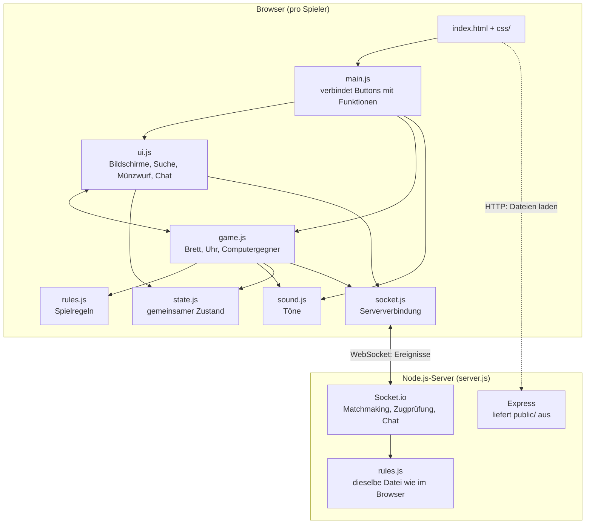
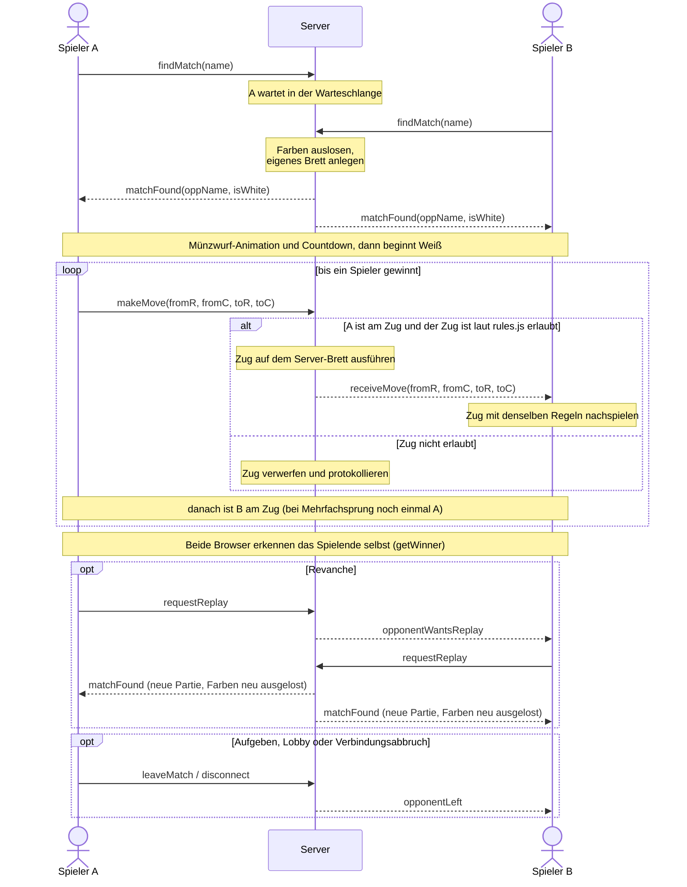

# Dame – Browser Multiplayer

Ein modernes, browserbasiertes Dame-Spiel, entwickelt als Projekt für den Kurs Web-Engineering an der DHBW. Der Fokus liegt aktuell auf einer sauberen Trennung von Benutzeroberfläche und Spiellogik im Frontend sowie einer intuitiven User Experience durch visuelles Feedback.

## Aktueller Funktionsumfang (Frontend)

- **Lobby & Validierung:** Namenseingabe mit Regex-Prüfung und Fail-Safes.
- **Münzwurf-Animation:** 3D-CSS-Animation zur zufälligen Bestimmung des Startspielers inkl. Bounce-Effekt.
- **Vollständige Regel-Engine** für die Variante „Klassisch“ (siehe [Spielregeln](#spielregeln)), inkl. automatischer Erkennung und roter Hervorhebung der Pflichtschläge.
- **UX-Features:** Optische Trophäen-Anzeige geschlagener Steine in der Kopfzeile, globale Deselektion ("Klick-ins-Leere") und Anzeige der Zugberechtigung.

## Spielregeln

Aktuell wird die Variante **„Klassisch“** gespielt. Eine zweite Variante „International“ (10×10) ist geplant.

### Variante „Klassisch“

**Aufbau**

- Brett mit 8×8 Feldern, gespielt wird nur auf den dunklen Feldern.
- Jede Seite beginnt mit 12 Steinen auf den ersten drei Reihen.
- Weiß beginnt.

**Ziehen**

- Normale Steine ziehen ein Feld diagonal **vorwärts**.
- Eine **Dame** zieht beliebig weit diagonal in alle vier Richtungen („fliegende Dame“).

**Schlagen**

- Normale Steine schlagen nur **vorwärts**: Sie springen über einen direkt benachbarten gegnerischen Stein auf das leere Feld dahinter.
- Eine Dame schlägt in alle Richtungen: Sie überspringt aus beliebiger Entfernung genau einen gegnerischen Stein und landet auf einem beliebigen freien Feld dahinter.
- Es gilt **Schlagzwang**: Kann ein Stein schlagen, muss geschlagen werden. Gibt es mehrere Möglichkeiten, ist die Wahl frei (kein Mehrheitsschlag).
- **Mehrfachsprung:** Kann derselbe Stein nach einem Schlag erneut schlagen, muss er weiterschlagen.
- Geschlagene Steine werden sofort vom Brett genommen.

**Beförderung**

- Ein Stein, der die gegnerische Grundlinie erreicht, wird zur Dame (gekennzeichnet durch eine Krone).
- Wird ein Stein während eines Schlags befördert, endet der Zug sofort.

**Spielende**

- Gewonnen hat, wessen Gegner keine Steine mehr hat **oder** keinen gültigen Zug mehr ausführen kann.
- Jede Seite hat 5 Minuten Bedenkzeit (Schachuhr-Prinzip). Wer die Zeit überschreitet, verliert.
- Wer aufgibt oder eine Online-Partie verlässt, verliert.

## Dateistruktur

Frontend ohne Frameworks (HTML, CSS und JavaScript als ES-Module), Server mit Node.js, Express und Socket.io:

```text
├── server.js            Node.js-Server: liefert public/ aus, Matchmaking, Zugprüfung, Chat
├── public/
│   ├── index.html       Alle Bildschirme (Modus, Anmeldung, Warten, Münzwurf, Spiel, Ende)
│   ├── css/             Styles, aufgeteilt in CSS-Layer (main.css legt die Reihenfolge fest)
│   └── js/
│       ├── main.js      Einstiegspunkt: verbindet Buttons und Formulare mit den Funktionen
│       ├── ui.js        Bildschirmwechsel, Suche, Münzwurf, Chat, Dialoge
│       ├── game.js      Brett anzeigen, Züge ausführen, Uhr, Computergegner
│       ├── rules.js     Spielregeln ohne HTML (wird auch vom Server genutzt)
│       ├── state.js     Gemeinsamer Zustand (Spielmodus, Namen, Farbe)
│       ├── socket.js    Gemeinsame Verbindung zum Server
│       └── sound.js     Töne über die Web Audio API
└── tests/
    ├── rules.test.js    Unit-Tests der Spielregeln
    └── server.test.js   Integrationstests gegen den echten Server
```

## Architektur



**Wichtige Entscheidungen:**

- **Gemeinsame Spielregeln:** `rules.js` arbeitet nur mit Daten (8×8-Array) und kennt kein HTML. Dadurch nutzen Browser und Server dieselbe Datei. Der Browser zeigt erlaubte Züge sofort an, der Server ist der Schiedsrichter und leitet nur erlaubte Züge weiter.
- **Server führt pro Partie ein eigenes Brett** und weiß, wer am Zug ist. Ein manipulierter Browser kann weder für den Gegner ziehen noch Regeln brechen.
- **Computergegner läuft komplett im Browser**, dafür ist keine Serververbindung nötig.
- **Bewusste Grenze:** Die Schachuhr läuft nur im Browser. Eine Server-Uhr wäre der nächste Schritt gegen Manipulation der Bedenkzeit.
- **Kein Build-Schritt:** ES-Module laufen direkt im Browser, CSS-Layer ersetzen `!important`.

## Kommunikationsablauf (Online-Partie)



## Socket.io-Ereignisse

| Ereignis              | Richtung         | Daten                          | Prüfung auf dem Server                                                  |
| --------------------- | ---------------- | ------------------------------ | ----------------------------------------------------------------------- |
| `findMatch`           | Browser → Server | Spielername                    | 2–16 Zeichen, nur Buchstaben und Ziffern                                |
| `cancelSearch`        | Browser → Server | –                              | –                                                                       |
| `matchFound`          | Server → Browser | `oppName`, `isWhite`           | –                                                                       |
| `makeMove`            | Browser → Server | `fromR`, `fromC`, `toR`, `toC` | ganze Zahlen 0–7, Spieler ist am Zug, Zug laut `rules.js` erlaubt       |
| `receiveMove`         | Server → Browser | `fromR`, `fromC`, `toR`, `toC` | nur geprüfte Züge werden weitergeleitet                                 |
| `chatMessage`         | beide Richtungen | Text                           | muss Text sein, wird gekürzt (max. 200 Zeichen), leere werden verworfen |
| `requestReplay`       | Browser → Server | –                              | –                                                                       |
| `opponentWantsReplay` | Server → Browser | –                              | –                                                                       |
| `leaveMatch`          | Browser → Server | –                              | –                                                                       |
| `opponentLeft`        | Server → Browser | –                              | –                                                                       |

Zusätzlich gilt: Nachrichten über 10 KB lehnt Socket.io ab, und jeder Handler läuft in `try/catch` (`onSafe`). Ein fehlerhaftes Ereignis bringt den Server also nicht zum Absturz.

## Lokale Ausführung

Voraussetzung: [Node.js](https://nodejs.org/) ab Version 18 (für die `.env`-Datei ab Version 20.12).

1. Repository klonen:
   `git clone https://github.com/flofries00/WebProgDHBWDame.git`
2. In den Projektordner wechseln und Abhängigkeiten installieren:
   `npm install`
3. Build-Schritt (es wird nichts kompiliert, der Befehl ist der Vollständigkeit halber vorhanden):
   `npm run build`
4. Server starten:
   `npm start` (Standard-Port 3000)
5. Im Browser `http://localhost:3000` öffnen.
   Für eine Online-Partie die Seite in einem zweiten Tab öffnen und in beiden „Gegen Mensch“ wählen.

### Port festlegen

Der Port kann auf drei Arten gesetzt werden (in dieser Priorität):

1. Als Argument: `npm start -- 8080`
2. Als Umgebungsvariable: `PORT=8080 npm start`
3. In einer Datei `.env` (Vorlage: `cp .env.example .env`)

Hinweis: `npm build` (ohne `run`) existiert in aktuellen npm-Versionen nicht, richtig ist `npm run build`.

### Tests ausführen

```bash
npm test
```

## Betrieb auf dem Ubuntu-Server

```bash
git clone https://github.com/flofries00/WebProgDHBWDame.git
cd WebProgDHBWDame
npm install
npm run build
nohup npm start -- 8080 > server.log 2>&1 &
```

Der Server läuft dann im Hintergrund weiter, auch nach dem Abmelden. Ausgaben stehen in `server.log`.
Beenden mit: `pkill -f "node server.js"`

## Nächste Entwicklungsschritte

- Barrierefreiheit: Tastaturbedienung des Bretts, Kontraste, Schriftgrößen
- Endbildschirm überarbeiten
- Optional: Zweite Variante "International" (10x10), Dark-Mode-Toggle, Tutorial
