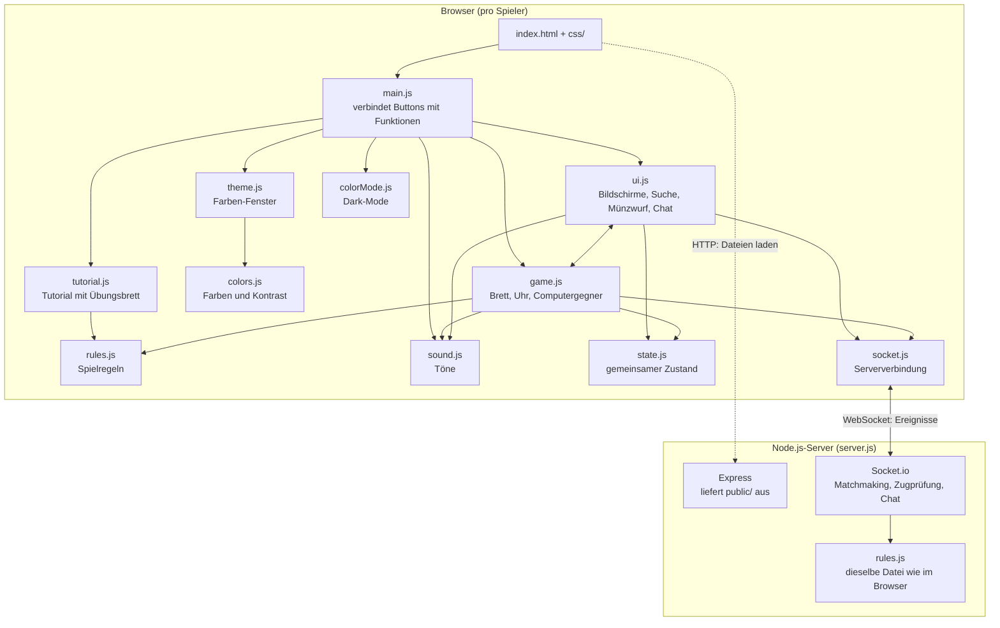
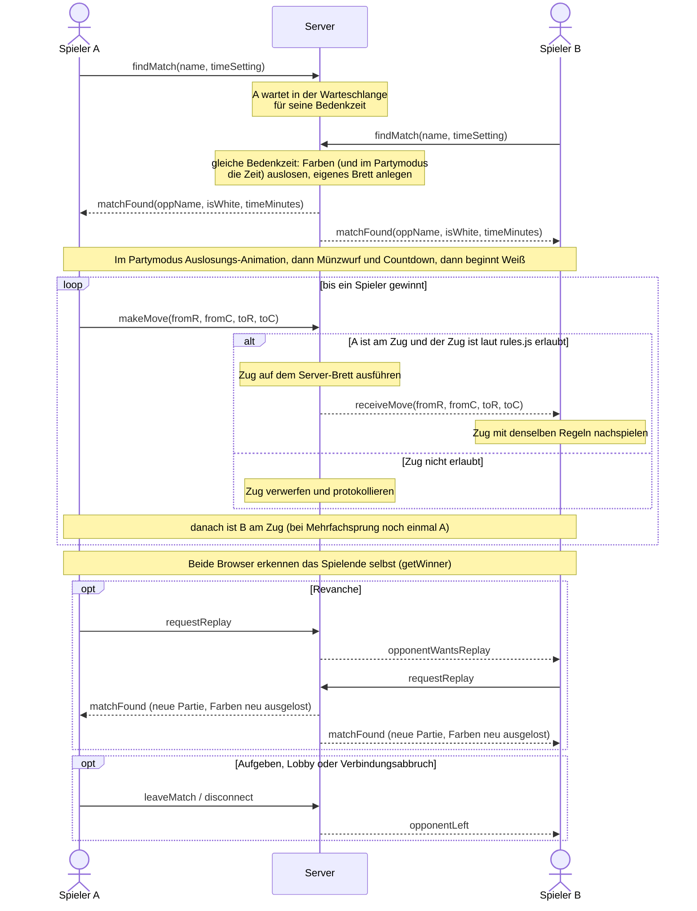

# Dame Online – Browser Multiplayer

Dame im Browser: gegen den Computer oder online gegen einen anderen Menschen. Entstanden als Projekt im Kurs
Web-Programmierung an der DHBW Mannheim. Das Frontend kommt ohne Frameworks aus (HTML, CSS und JavaScript als
ES-Module), der Server läuft mit Node.js, Express und Socket.io und prüft jeden Online-Zug selbst.

## Funktionsumfang

**Spielen**

- **Zwei Modi:** gegen den Computer oder online gegen einen anderen Menschen, mit Chat und Revanche.
- **Zwei Varianten mit vollständigen Spielregeln** (siehe [Spielregeln](#spielregeln)): „Klassisch“ (8×8) und
  „International“ (10×10, Rückwärtsschlagen und Mehrheitsschlag). Schlagzwang, Mehrfachsprung, fliegende Dame.
  Pflichtschläge werden automatisch rot markiert und lassen sich direkt anklicken.
- **Bedenkzeit wählbar:** 1, 3, 5 oder 10 Minuten pro Spieler oder Partymodus (für beide dieselbe Zufallszeit von 1 bis
  10 Minuten, mit eigener Auslosung). Online spielen nur Spieler mit derselben Variante und Bedenkzeit gegeneinander,
  der Setup-Bildschirm zeigt, wo gerade jemand wartet.
- **Münzwurf** um die Farbe, Countdown bis zum Start, Konfetti oder Regen am Ende, Spielverlauf und Endstand.

**Bedienung und Oberfläche**

- Ziehen per **Klick, Drag & Drop** (Maus, Finger und Stift über Pointer Events) oder **Tastatur**.
- **Farbauswahl:** 8 Brett- und 4 Steinvorlagen oder eigene Farben, mit Live-Vorschau und Kontrastprüfung. Die Wahl
  wird im Browser gespeichert.
- **Dark-Mode:** folgt automatisch der Einstellung des Betriebssystems, lässt sich per Button in der Kopfzeile umschalten. Die Wahl wird im Browser gespeichert
- **Hilfe-Fenster** (?) mit Bedienung, Markierungen und Regeln.
- **Interaktives Tutorial** mit Übungsbrett: 6 Lektionen (Ziehen, Schlagen, Schlagzwang, Mehrfachsprung, Dame, Damenzug). Öffnet sich beim ersten Besuch, danach über die Startseite oder das Hilfe-Fenster
- **Responsive** von 320px (Handy) bis zum großen Monitor, das Brett passt sich der Fensterhöhe an.
- Töne für Züge, Münzwurf und Spielende, erzeugt per Web Audio API (abschaltbar).

**Sicherheit**

- Der Server führt für jede Partie ein eigenes Brett und **prüft jeden Zug** mit denselben Regeln wie der Browser
  (`rules.js`). Unerlaubte oder gefälschte Züge werden verworfen.
- Namen, Bedenkzeit und Chatnachrichten werden auch serverseitig geprüft, Nachrichten werden nur als Text angezeigt.

## Spielregeln

Es gibt zwei Varianten, ausgewählt wird im Setup-Bildschirm vor der Partie. Die Unterschiede legt `VARIANTS` in
`rules.js` fest.

### Variante „Klassisch“

**Aufbau**

- Brett mit 8×8 Feldern, gespielt wird nur auf den dunklen Feldern.
- Jede Seite beginnt mit 12 Steinen auf den ersten drei Reihen.
- Weiß beginnt.

**Ziehen**

- Normale Steine ziehen ein Feld diagonal **vorwärts**.
- Eine **Dame** zieht beliebig weit diagonal in alle vier Richtungen („fliegende Dame“).

**Schlagen**

- Normale Steine schlagen nur **vorwärts**: Sie springen über einen direkt benachbarten gegnerischen Stein auf das leere Feld dahinter.
- Eine Dame schlägt in alle Richtungen: Sie überspringt aus beliebiger Entfernung genau einen gegnerischen Stein und landet auf einem beliebigen freien Feld dahinter.
- Es gilt **Schlagzwang**: Kann ein Stein schlagen, muss geschlagen werden. Gibt es mehrere Möglichkeiten, ist die Wahl frei (kein Mehrheitsschlag).
- **Mehrfachsprung:** Kann derselbe Stein nach einem Schlag erneut schlagen, muss er weiterschlagen.
- Geschlagene Steine werden sofort vom Brett genommen.

**Beförderung**

- Ein Stein, der die gegnerische Grundlinie erreicht, wird zur Dame (gekennzeichnet durch eine Krone).
- Wird ein Stein während eines Schlags befördert, endet der Zug sofort.

**Spielende**

- Gewonnen hat, wessen Gegner keine Steine mehr hat **oder** keinen gültigen Zug mehr ausführen kann.
- Jede Seite hat dieselbe Bedenkzeit (1, 3, 5 oder 10 Minuten, im Partymodus ausgelost), es gilt das Schachuhr-Prinzip. Wer die Zeit überschreitet, verliert.
- Wer aufgibt oder eine Online-Partie verlässt, verliert.

### Variante „International“

Wie „Klassisch“, mit diesen Unterschieden (Regeln des Weltverbands FMJD):

- Brett mit 10×10 Feldern, jede Seite beginnt mit 20 Steinen auf den ersten vier Reihen.
- Normale Steine ziehen nur vorwärts, schlagen aber auch **rückwärts**.
- **Mehrheitsschlag:** Gibt es mehrere Schlagmöglichkeiten, muss die gewählt werden, mit der insgesamt die meisten
  gegnerischen Steine geschlagen werden (Damen zählen wie normale Steine).
- Geschlagene Steine bleiben bis zum Ende des Zugs liegen (halb durchsichtig angezeigt) und dürfen nicht zweimal
  übersprungen werden.
- Ein Stein wird nur zur Dame, wenn sein Zug auf der gegnerischen Grundlinie **endet**. Muss er von dort weiterschlagen,
  bleibt er ein normaler Stein.

## Barrierefreiheit

- **Tastatur:** Das Brett besteht aus Buttons. Mit Tab gelangt man aufs Brett, mit den Pfeiltasten bewegt man sich, mit
  Enter oder Leertaste wird ausgewählt und gezogen, Escape hebt die Auswahl auf. Der Fokusrahmen ist zweifarbig und auf
  jedem Feld sichtbar.
- **Screenreader:** Jedes Feld hat eine Beschriftung (z.B. „D4, leer, hierhin ziehen“), neue Züge im Spielverlauf und
  Hinweise werden angesagt.
- **Nicht nur Farbe:** Zugfelder haben einen Punkt, Schlagfelder einen Ring.
- **Kontrast** nach WCAG 2.1 (Text mindestens 4,5:1, Grafiken mindestens 3:1), auch für alle Farbvorlagen. Bei eigenen
  Farben warnt die Farbauswahl vor schwer erkennbaren Kombinationen.
- **Schrift** überall mindestens 16px mit Zeilenabstand 1,5. Wer im Betriebssystem „Bewegung reduzieren“ eingestellt
  hat, bekommt kein Konfetti und keinen Regen.

## Qualitätssicherung

- **Automatische Tests** mit `node:test` (`npm test`): Spielregeln, Farblogik und Kontrast sowie Integrationstests gegen
  den echten Server (Matchmaking, Zugprüfung, Chat, Revanche, Warteschlangen).
- **ESLint** (`npm run lint`) und **Prettier** (`npm run format:check`) für einheitlichen, fehlerarmen Code.

## Dateistruktur

Frontend ohne Frameworks (HTML, CSS und JavaScript als ES-Module), Server mit Node.js, Express und Socket.io:

```text
├── server.js            Node.js-Server: liefert public/ aus, Matchmaking, Zugprüfung, Chat
├── LICENSE              MIT-Lizenz
├── public/
│   ├── index.html       Alle Bildschirme (Modus, Name, Setup, Warten, Münzwurf, Spiel, Ende) und Dialoge
│   ├── css/             Styles, aufgeteilt in CSS-Layer (main.css legt die Reihenfolge fest)
│   └── js/
│       ├── main.js      Einstiegspunkt: verbindet Buttons und Formulare mit den Funktionen
│       ├── ui.js        Bildschirmwechsel, Suche, Münzwurf, Chat, Dialoge
│       ├── game.js      Brett anzeigen, Züge ausführen, Uhr, Computergegner
│       ├── rules.js     Spielregeln ohne HTML (wird auch vom Server genutzt)
│       ├── state.js     Gemeinsamer Zustand (Spielmodus, Namen, Farbe, Bedenkzeit)
│       ├── socket.js    Gemeinsame Verbindung zum Server
│       ├── sound.js     Töne über die Web Audio API
│       ├── theme.js     Farben-Fenster: Vorlagen, eigene Farben, Vorschau, Speichern im Browser
│       ├── colorMode.js    Dark-Mode: helles oder dunkles Design der Seite umschalten und merken
│       ├── tutorial.js  Interaktives Tutorial: Lektionen auf einem Übungsbrett
│       └── colors.js    Farbvorlagen und Kontrastprüfung nach WCAG ohne HTML (testbar wie rules.js)
└── tests/
    ├── rules.test.js    Unit-Tests der Spielregeln
    ├── colors.test.js   Unit-Tests der Farblogik (Kontrast, Warnungen, Speicherstand)
    └── server.test.js   Integrationstests gegen den echten Server
```

## Architektur



**Wichtige Entscheidungen:**

- **Gemeinsame Spielregeln:** `rules.js` arbeitet nur mit Daten (8×8- bzw. 10x10-Array) und kennt kein HTML. Dadurch nutzen Browser und Server dieselbe Datei. Der Browser zeigt erlaubte Züge sofort an, der Server ist der Schiedsrichter und leitet nur erlaubte Züge weiter.
- **Server führt pro Partie ein eigenes Brett** und weiß, wer am Zug ist. Ein manipulierter Browser kann weder für den Gegner ziehen noch Regeln brechen.
- **Computergegner läuft komplett im Browser**, dafür ist keine Serververbindung nötig.
- **Bewusste Grenze:** Die Schachuhr läuft nur im Browser. Eine Server-Uhr wäre der nächste Schritt gegen Manipulation der Bedenkzeit.
- **Kein Build-Schritt:** ES-Module laufen direkt im Browser, CSS-Layer ersetzen `!important`.

## Kommunikationsablauf (Online-Partie)



## Socket.io-Ereignisse

| Ereignis              | Richtung         | Daten                                                      | Prüfung auf dem Server                                                                                                                                                    |
| --------------------- | ---------------- | ---------------------------------------------------------- | ------------------------------------------------------------------------------------------------------------------------------------------------------------------------- |
| `findMatch`           | Browser → Server | Spielername, Bedenkzeit, Variante                          | Name: 2–16 Zeichen, nur Buchstaben und Ziffern; Zeit: `1`, `3`, `5`, `10` oder `party` (Standard `5`); Variante: `klassisch` oder `international` (Standard: `klassisch`) |
| `cancelSearch`        | Browser → Server | –                                                          | –                                                                                                                                                                         |
| `matchFound`          | Server → Browser | `oppName`, `isWhite`, `timeMinutes`                        | –                                                                                                                                                                         |
| `queueStatus`         | Server → Browser | `waiting` (pro Variante und Bedenkzeit 0 oder 1), `online` | – (wird bei jeder Änderung an alle geschickt)                                                                                                                             |
| `makeMove`            | Browser → Server | `fromR`, `fromC`, `toR`, `toC`                             | ganze Zahlen auf dem Brett (0-7 bzw. 0-9), Spieler ist am Zug, Zug laut `rules.js` erlaubt                                                                                |
| `receiveMove`         | Server → Browser | `fromR`, `fromC`, `toR`, `toC`                             | nur geprüfte Züge werden weitergeleitet                                                                                                                                   |
| `chatMessage`         | beide Richtungen | Text                                                       | muss Text sein, wird gekürzt (max. 200 Zeichen), leere werden verworfen                                                                                                   |
| `requestReplay`       | Browser → Server | –                                                          | –                                                                                                                                                                         |
| `opponentWantsReplay` | Server → Browser | –                                                          | –                                                                                                                                                                         |
| `leaveMatch`          | Browser → Server | –                                                          | –                                                                                                                                                                         |
| `opponentLeft`        | Server → Browser | –                                                          | –                                                                                                                                                                         |

Zusätzlich gilt: Nachrichten über 10 KB lehnt Socket.io ab, und jeder Handler läuft in `try/catch` (`onSafe`). Ein fehlerhaftes Ereignis bringt den Server also nicht zum Absturz.

## Lokale Ausführung

Voraussetzung: [Node.js](https://nodejs.org/) ab Version 18 (für die `.env`-Datei ab Version 20.12).

1. Repository klonen:
   `git clone https://github.com/flofries00/WebProgDHBWDame.git`
2. In den Projektordner wechseln und Abhängigkeiten installieren:
   `npm install`
3. Build-Schritt (es wird nichts kompiliert, der Befehl ist der Vollständigkeit halber vorhanden):
   `npm run build`
4. Server starten:
   `npm start` (Standard-Port 3000)
5. Im Browser `http://localhost:3000` öffnen.
   Für eine Online-Partie die Seite in einem zweiten Tab öffnen und in beiden „Gegen Mensch“ wählen.

### Port festlegen

Der Port kann auf drei Arten gesetzt werden (in dieser Priorität):

1. Als Argument: `npm start -- 8080`
2. Als Umgebungsvariable: `PORT=8080 npm start`
3. In einer Datei `.env` (Vorlage: `cp .env.example .env`)

Hinweis: `npm build` (ohne `run`) existiert in aktuellen npm-Versionen nicht, richtig ist `npm run build`.

### Tests ausführen

```bash
npm test
```

## Betrieb auf dem Ubuntu-Server

```bash
git clone https://github.com/flofries00/WebProgDHBWDame.git
cd WebProgDHBWDame
npm install
npm run build
nohup npm start -- 8080 > server.log 2>&1 &
```

Der Server läuft dann im Hintergrund weiter, auch nach dem Abmelden. Ausgaben stehen in `server.log`.
Beenden mit: `pkill -f "node server.js"`

## Mögliche Erweiterungen

- Private Räume für Partien mit Freunden

## Autor

Florian Fries – Wirtschaftsinformatik, DHBW Mannheim

## Lizenz

[MIT](LICENSE)
